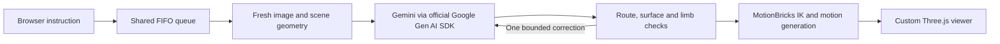

# Architecture

The director lives beside MotionBricks' existing `app` code after installation.
MotionBricks itself and all assets stay in the separately downloaded checkout.

`app/director/models.py` defines immutable Pydantic input contracts.
`spatial.py` extracts scene geometry and validates floor routes. `contact.py`
validates goals against oriented cuboid surfaces and resolves world coordinates
in the character's current frame. `body_runtime.py` uses upstream IK to construct
the full skeleton target; planted feet and lower pelvis can bend the legs.

`planner.py` sends text, geometry and a JPEG through `google-genai`. The model
chooses new numbers rather than selecting a preset body-pose asset. Walking and
authored gym interactions still consume MotionBricks assets. Validation rejects
unreachable or invalid goals. An initial validation repair and a runtime pose
repair are each bounded; failed commands free the queue for the next instruction.

`director_demo.py` owns execution and queue lifecycle. Planning begins only when a
command reaches the front, so it uses current observations. One character accepts
one active instruction and eight waiting instructions. The queue is in memory.
Viewer identifiers label tabs and are not authentication.

`director_web.py` adapts the runtime to FastAPI with one Uvicorn worker. It sends
binary skeletal poses and compact JSON state over WebSockets, including the
configured model ID. It never sends the API key to the browser. The newest frame
replaces any unsent frame for a slow client.

React mounts the controls once. TanStack Query owns scene fetching and command
mutations. XState owns reconnection. Three.js rendering and timestamp-based pose
interpolation run outside React; there is no state update per animation frame.
shadcn/ui and Lucide supply the control components and icons. Manrope is served
locally, without a runtime font-service request.

The amber marker is a generated world-space hand goal. The green marker is the
measured hand joint. Cyan is the solved body target. Before-hold error measures a
sample of the generated transition; held error measures the exact solved pose.
Surface placement is kinematic. Balance, contact forces, arbitrary rotations,
self-collision and all-body obstacle avoidance are not implemented.

## Integration patch

The patch targets upstream commit `54fc563aeaaf819a753d72cc9fdc6713989cdd43`.
It adds a command hook before each character step and an optional exact ground
stopping position through the locomotion/idle path. It includes no upstream
assets. The installer checks the commit, patch and destination files before
making changes. All upstream source and license notices remain in the user's
MotionBricks checkout.
